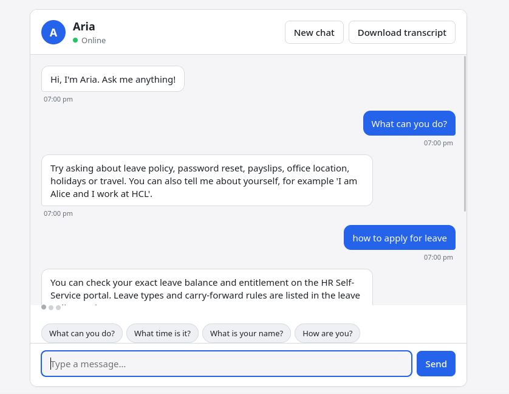

# Aria Chatbot 🤖


**Aria** is an enterprise-grade, context-aware, rule-based chatbot built in Python. It features a strictly decoupled architecture, utilizing ONLY the Python standard library for its core logic, while exposing the system via a FastAPI REST backend and a responsive vanilla JavaScript web interface.

---

## 📸 Demo & Screenshots

> **Working Video Demo:** [Click here to watch the Aria Chatbot demo on YouTube](https://drive.google.com/drive/u/2/folders/1LSBf3YHhZC5-e5BZ4jXdS-cpm3HzqCNL)

  

---

## ✨ Key Features

- **Pure Standard Library Core:** The `aria` package uses zero external dependencies (only `re`, `json`, `dataclasses`, `enum`, `logging`, etc.).
- **Context Awareness:** Remembers user facts (e.g., Name, Company) across the session and detects repeated questions.
- **Intent Priority Engine:** Uses pre-compiled regex patterns and a priority-based tie-breaker to determine the user's intent.
- **Dual Interfaces:** 
  - A command-line interface (CLI) with argument parsing.
  - A fully interactive, responsive Web UI.
- **Session Management:** Built-in idle session expiry (30 mins) and thread-safe per-session memory locks.
- **Config-Driven:** All intents, patterns, and responses live in `config/intents.json` — no hardcoded logic.

---

## 🏗️ System Architecture

Aria is built using principles of **Hexagonal Architecture** (Ports and Adapters). The core domain is completely isolated from the delivery mechanisms (CLI/Web).

### Architecture Diagram

```text
       +-------------------------------------------------+
       |               PRESENTATION LAYER                |
       |  +-------------------+  +--------------------+  |
       |  |  CLI (argparse)   |  |  Web (HTML/JS/CSS) |  |
       |  +---------+---------+  +---------+----------+  |
       +------------|----------------------|-------------+
                    |                      | (HTTP)
       +------------v----------------------v-------------+
       |               APPLICATION LAYER                 |
       |  +-------------------+  +--------------------+  |
       |  |  cli.py           |  |  web/api.py        |  |
       |  |  (Terminal I/O)   |  |  (FastAPI Routes)  |  |
       |  +---------+---------+  +---------+----------+  |
       |            |                      |             |
       |            |                      v             |
       |            |            +--------------------+  |
       |            |            |  web/session_store |  |
       |            |            |  (Thread-safe Map) |  |
       |            |            +---------+----------+  |
       +------------|----------------------|-------------+
                    |                      |
       +------------v----------------------v-------------+
       |                 CORE DOMAIN LAYER               |
       |  +--------------------------------------------+ |
       |  |               Chatbot Facade               | |
       |  |  (Orchestrates memory, matching, & replies)| |
       |  +---------+------------------+---------------+ |
       |            |                  |                 |
       |  +---------v--------+  +------v---------+       |
       |  | PatternMatcher   |  | ContextManager |       |
       |  | (Regex Engine)   |  | (Memory/Facts) |       |
       |  +---------+--------+  +------+---------+       |
       |            |                  |                 |
       |            +--------+---------+                 |
       |                     |                           |
       |            +--------v---------+                 |
       |            | ResponseGenerator|                 |
       |            | (Template Engine)|                 |
       |            +------------------+                 |
       +-------------------------------------------------+